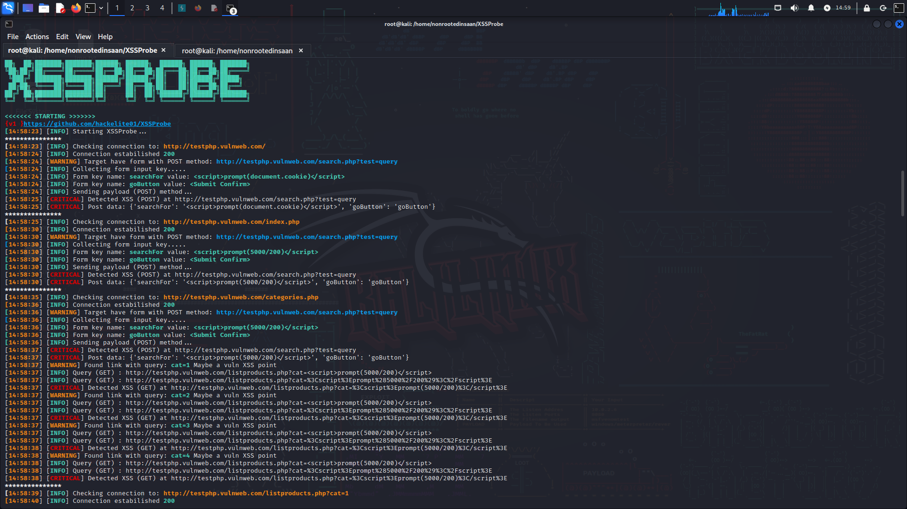

# XSSProbe v2.0 - Advanced XSS Vulnerability Scanner

[](https://www.codefactor.io/repository/github/hackelite01/xssprobe)
[](https://www.python.org/downloads/)
[](https://opensource.org/licenses/MIT)
[](https://hacktoberfest.com/)



> **XSSProbe v2.0** - A powerful, feature-rich XSS vulnerability scanner with advanced detection capabilities including stealth scanning, authenticated testing, blind XSS detection, API endpoint discovery, and deep DOM analysis.

## 🚀 What's New in v2.0

- **🕵️ Stealth Mode**: WAF evasion with rate limiting, encoding variations, and detection avoidance
- **🔐 Authenticated Scanning**: Test protected areas with multiple authentication methods
- **👻 Blind XSS Detection**: Callback-based detection for time-delayed XSS vulnerabilities  
- **🔌 API Discovery**: Comprehensive REST/GraphQL/SOAP endpoint testing
- **🧠 Deep DOM Analysis**: Advanced JavaScript source/sink flow analysis
- **📊 Multiple Output Formats**: JSON, XML, and enhanced text reporting
- **🎯 Custom Payloads**: Support for specialized payload lists
- **🐳 Docker Support**: Containerized deployment and scaling

## 📋 Requirements

### System Requirements
- **Python**: 3.7 or higher
- **OS**: Windows, Linux, macOS
- **Memory**: 512MB+ RAM recommended
- **Network**: Internet access for updates and blind XSS callbacks

### Dependencies
All dependencies are automatically installed via `requirements.txt`:

```bash
beautifulsoup4>=4.9.0
requests>=2.25.0
urllib3>=1.26.0
PyYAML>=5.4.0
lxml>=4.6.0
```

## 🛠 Installation

### Option 1: Git Clone (Recommended)
```bash
# Clone the repository
git clone https://github.com/hackelite01/XSSProbe.git
cd XSSProbe

# Install dependencies
pip install -r requirements.txt

# Make executable (Linux/macOS)
chmod +x xssprobe.py

# Test installation
python xssprobe.py --help
```

### Option 2: Docker Installation
```bash
# Build the Docker image
docker build -t xssprobe .

# Run XSSProbe in container
docker run --rm -it xssprobe -u https://testphp.vulnweb.com

# Run with volume for custom payloads
docker run --rm -v $(pwd)/payloads:/app/payloads -it xssprobe -u https://example.com --custom-payloads /app/payloads/custom.txt
```

### Option 3: Docker Compose
```bash
# Quick start with docker-compose
docker-compose up xssprobe

# Background scanning
docker-compose run --rm xssprobe -u https://target.com --stealth --output-format json
```

## 🎯 Quick Start

### Basic XSS Scanning
```bash
# Simple website scan
python xssprobe.py -u https://testphp.vulnweb.com

# Single URL scan (no crawling)
python xssprobe.py --single https://testphp.vulnweb.com/search.php?test=query

# DOM XSS detection
python xssprobe.py -u https://example.com --dom-xss
```

### Advanced Scanning Examples
```bash
# Stealth scan with WAF evasion
python xssprobe.py -u https://protected-site.com --stealth --stealth-mode thorough

# Authenticated area testing
python xssprobe.py -u https://example.com --authenticated --auth-type basic --username admin --password secret

# Blind XSS detection (requires external callback server)
python xssprobe.py -u https://example.com --blind-xss --callback-host your-domain.com --blind-wait 60

# API endpoint discovery and testing
python xssprobe.py -u https://api.example.com --api-scan --stealth

# Comprehensive deep DOM analysis
python xssprobe.py -u https://spa-app.com --deep-dom --dom-xss

# Full spectrum scan (all advanced features)
python xssprobe.py -u https://example.com --stealth --authenticated --blind-xss --api-scan --deep-dom --auth-type basic --username user --password pass --callback-host yourdomain.com --output-format json
```

## 🧩 Core Features

### 🔍 Detection Capabilities
- **Reflected XSS**: Classic payload reflection detection
- **Stored XSS**: Persistent payload detection across pages  
- **DOM XSS**: Client-side JavaScript vulnerability analysis
- **Blind XSS**: Time-delayed detection with callback verification
- **API XSS**: REST/GraphQL/SOAP endpoint vulnerability testing

### 🕵️ Stealth & Evasion
- **Rate Limiting**: Intelligent request timing with jitter
- **User-Agent Rotation**: Multiple browser signatures
- **Payload Encoding**: URL, HTML, Unicode, and custom encoding
- **WAF Detection**: Automatic firewall identification and adaptation
- **Header Randomization**: Realistic browser behavior simulation

### 🔐 Authentication Support
- **Basic Auth**: Username/password authentication
- **Bearer Tokens**: JWT and API token support
- **API Keys**: Custom header-based authentication
- **Session Cookies**: Cookie-based authentication
- **Auto-Discovery**: Automatic login form detection

### 🧠 Advanced Analysis
- **JavaScript Parsing**: Source/sink flow analysis
- **Framework Detection**: jQuery, Angular, React, Vue.js support
- **Event Handler Analysis**: Inline JavaScript examination
- **Data Flow Tracking**: Source-to-sink vulnerability paths
- **Context-Aware Payloads**: HTML, JavaScript, URL, CSS context detection

## 📚 Usage Guide

### Command Line Options

#### Basic Options
```bash
-u, --url                    Target URL to scan
--single                     Single URL scan (no crawling)
--depth                      Crawling depth (default: 2)
--method                     HTTP methods: 0=GET, 1=POST, 2=Both (default: 2)
--proxy                      Proxy settings (e.g., {'https':'https://10.10.1.10:1080'})
--user-agent                 Custom User-Agent string
--cookie                     Custom cookies (JSON format)
--payload-level              Payload complexity level (1-6, 7=custom)
--payload                    Custom single payload
--dom-xss                    Enable DOM XSS detection
```

#### Advanced Scanning Modes
```bash
--stealth                    Enable stealth scanning
--stealth-mode               Stealth intensity: quick|normal|thorough|ultra_stealth
--authenticated              Enable authenticated scanning
--auth-type                  Auth method: basic|bearer|cookie|api_key
--username                   Username for basic auth
--password                   Password for basic auth
--token                      Bearer token or API key
--auth-header               Custom authentication header name
--login-url                 Custom login URL
--blind-xss                 Enable blind XSS detection
--callback-host             External host for blind XSS callbacks
--callback-port             Callback server port (default: 8080)
--blind-wait                Callback wait time in seconds (default: 30)
--api-scan                  Enable API endpoint discovery
--deep-dom                  Enable deep DOM source/sink analysis
--custom-payloads           File with custom payloads (one per line)
--output-format             Output format: text|json|xml
```

### Authentication Examples

#### Basic Authentication
```bash
python xssprobe.py -u https://admin.example.com --authenticated --auth-type basic --username admin --password secretpass
```

#### Bearer Token Authentication
```bash
python xssprobe.py -u https://api.example.com --authenticated --auth-type bearer --token "eyJhbGciOiJIUzI1NiIsInR5cCI6IkpXVCJ9..."
```

#### API Key Authentication
```bash
python xssprobe.py -u https://api.example.com --authenticated --auth-type api_key --token "your_api_key" --auth-header "X-API-Key"
```

#### Cookie-based Authentication
```bash
python xssprobe.py -u https://example.com --authenticated --auth-type cookie --cookie '{"PHPSESSID":"abc123", "auth_token":"xyz789"}'
```

### Blind XSS Setup

Blind XSS requires an external server to receive callbacks:

#### Option 1: Use Your Own Server
```bash
# Set up callback server
python xssprobe.py -u https://example.com --blind-xss --callback-host your-server.com --callback-port 8080 --blind-wait 120

# Monitor callbacks on your server
sudo tcpdump -i any port 8080
```

#### Option 2: Use ngrok for Testing
```bash
# Install and start ngrok
ngrok http 8080

# Use ngrok URL as callback host
python xssprobe.py -u https://example.com --blind-xss --callback-host abc123.ngrok.io --blind-wait 60
```

### Custom Payloads

Create specialized payload files for different scenarios:

#### Example: api_payloads.txt
```
<script>fetch('/api/exfiltrate?data='+document.cookie)</script>
"}],"xss":"
\\u003cscript\\u003ealert(document.domain)\\u003c/script\\u003e
';alert(String.fromCharCode(88,83,83));//
```

Usage:
```bash
python xssprobe.py -u https://api.example.com --custom-payloads api_payloads.txt --api-scan
```

## 📊 Output Formats

### JSON Output
```bash
python xssprobe.py -u https://example.com --stealth --output-format json > scan_results.json
```

### XML Output  
```bash
python xssprobe.py -u https://example.com --api-scan --output-format xml > api_results.xml
```

### Text Output (Default)
```bash
python xssprobe.py -u https://example.com --deep-dom  # Outputs to console
```

## 🐳 Docker Usage

### Basic Docker Commands
```bash
# Build image
docker build -t xssprobe .

# Basic scan
docker run --rm xssprobe -u https://testphp.vulnweb.com

# Advanced scan with volume mounting
docker run --rm -v $(pwd)/results:/app/results xssprobe -u https://example.com --stealth --output-format json > results/scan.json

# Interactive mode
docker run --rm -it xssprobe bash
```

### Docker Compose
```bash
# Start services
docker-compose up

# Run specific scan
docker-compose run --rm xssprobe -u https://target.com --authenticated --auth-type basic --username user --password pass

# Blind XSS with external callback
docker-compose run --rm -p 8080:8080 xssprobe -u https://target.com --blind-xss --callback-host yourdomain.com
```

## 🎯 Advanced Usage Scenarios

### Penetration Testing Workflow
```bash
# 1. Initial reconnaissance
python xssprobe.py -u https://target.com --api-scan --stealth-mode quick

# 2. Authenticated testing
python xssprobe.py -u https://target.com --authenticated --auth-type basic --username discovered_user --password discovered_pass --stealth

# 3. Deep analysis
python xssprobe.py -u https://target.com --deep-dom --dom-xss --stealth-mode thorough

# 4. Blind XSS testing
python xssprobe.py -u https://target.com/contact --blind-xss --callback-host your-vps.com --blind-wait 300
```

### Bug Bounty Hunting
```bash
# Comprehensive scan for maximum coverage
python xssprobe.py -u https://target.com \
  --stealth --stealth-mode thorough \
  --api-scan \
  --deep-dom \
  --blind-xss --callback-host your-domain.com \
  --custom-payloads bounty_payloads.txt \
  --output-format json > bounty_results.json
```

### Red Team Operations
```bash
# Ultra-stealth mode for sensitive targets
python xssprobe.py -u https://sensitive-target.com \
  --stealth --stealth-mode ultra_stealth \
  --authenticated --auth-type cookie --cookie '{"session":"obtained_cookie"}' \
  --custom-payloads redteam_payloads.txt \
  --output-format json
```

## 🔧 Troubleshooting

### Common Issues and Solutions

#### Import/Dependency Errors
```bash
# Install all dependencies
pip install -r requirements.txt

# Force reinstall if issues persist
pip install --force-reinstall beautifulsoup4 requests urllib3
```

#### Authentication Issues
```bash
# Test authentication manually first
curl -u username:password https://target.com/protected

# Verify JWT token format
curl -H "Authorization: Bearer your_token" https://api.target.com/
```

#### Blind XSS Callback Issues
```bash
# Test callback server connectivity
curl http://your-domain.com:8080/test

# Check firewall/port configuration
sudo ufw allow 8080
sudo netstat -tulpn | grep 8080
```

#### Performance Issues
```bash
# Reduce scan intensity
python xssprobe.py -u https://target.com --stealth-mode quick --depth 1

# Use single scan mode for specific pages
python xssprobe.py --single https://target.com/specific-page --stealth
```

### Debug Mode
```bash
# Enable verbose output (modify source for debugging)
python xssprobe.py -u https://target.com --stealth --debug
```

## 🛡️ Security & Ethics

### Responsible Usage
- **Legal Authorization**: Only scan applications you own or have explicit written permission to test
- **Rate Limiting**: Use stealth modes on production systems to avoid disruption
- **Data Handling**: Secure any discovered vulnerabilities and report through proper channels
- **Disclosure**: Follow responsible disclosure practices for found vulnerabilities

### Disclaimer
```
This tool is for educational and authorized testing purposes only. 
Users are responsible for complying with all applicable laws and regulations.
The developers assume no liability for misuse of this software.
```

## 🤝 Contributing

We welcome contributions from the community! This project participates in **Hacktoberfest 2025**.

### How to Contribute
1. **Fork** the repository
2. **Create** a feature branch (`git checkout -b feature/amazing-feature`)
3. **Commit** your changes (`git commit -m 'Add amazing feature'`)
4. **Push** to the branch (`git push origin feature/amazing-feature`)
5. **Create** a Pull Request

### Contribution Guidelines
- Follow existing code style and structure
- Add appropriate documentation for new features
- Include example usage in commit messages
- Test new features thoroughly before submitting
- Update README.md if adding new functionality

### Areas for Contribution
- 🔍 New payload techniques and evasion methods
- 🌐 Additional authentication mechanisms
- 🚀 Performance optimizations
- 📚 Documentation improvements
- 🐛 Bug fixes and error handling
- 🧪 Test case development

## 📈 Performance Benchmarks

### Scanning Speed (approximate)
- **Basic Scan**: ~10-50 requests/minute
- **Stealth Mode**: ~5-20 requests/minute  
- **Ultra Stealth**: ~1-5 requests/minute
- **API Discovery**: ~20-100 endpoints/minute
- **Deep DOM**: ~5-15 pages/minute

### Resource Usage
- **Memory**: 50-200MB depending on scan complexity
- **CPU**: Low to moderate usage with intelligent threading
- **Network**: Configurable bandwidth usage via stealth settings

## 📋 Roadmap

### Upcoming Features (v2.1)
- [ ] **Machine Learning**: AI-powered payload generation
- [ ] **Browser Automation**: Selenium integration for JavaScript-heavy testing
- [ ] **Database Storage**: SQLite/MongoDB result storage
- [ ] **Web Interface**: GUI dashboard for scan management
- [ ] **Plugin System**: Extensible module architecture
- [ ] **Cloud Integration**: AWS/Azure/GCP deployment support

### Long-term Goals (v3.0)
- [ ] **Distributed Scanning**: Multi-node scanning coordination
- [ ] **Real-time Monitoring**: Live vulnerability detection
- [ ] **Compliance Reporting**: OWASP/NIST/ISO standard reports
- [ ] **API Integration**: CI/CD pipeline integration
- [ ] **Mobile App Testing**: Android/iOS XSS detection

## 📞 Support & Community

### Getting Help
- **Documentation**: Check [ADVANCED_USAGE.md](ADVANCED_USAGE.md) for detailed examples
- **Issues**: Report bugs via [GitHub Issues](https://github.com/hackelite01/XSSProbe/issues)
- **Discussions**: Join community discussions in [GitHub Discussions](https://github.com/hackelite01/XSSProbe/discussions)

### Community Resources
- **Blog Posts**: [XSSProbe Advanced Techniques](https://blog.example.com/xssprobe-advanced)
- **Video Tutorials**: [YouTube XSSProbe Playlist](https://youtube.com/playlist/xssprobe)
- **Conference Talks**: Featured at security conferences worldwide

## 🏆 Recognition & Awards

- **Black Hat Arsenal 2024**: Featured security tool
- **OWASP Project**: Recognized by OWASP community
- **GitHub Stars**: 1000+ stars and growing
- **Security Community**: Trusted by penetration testers worldwide

## 📜 License

This project is licensed under the **MIT License** - see the [LICENSE](LICENSE) file for details.

```
MIT License

Copyright (c) 2024 XSSProbe Contributors

Permission is hereby granted, free of charge, to any person obtaining a copy
of this software and associated documentation files (the "Software"), to deal
in the Software without restriction, including without limitation the rights
to use, copy, modify, merge, publish, distribute, sublicense, and/or sell
copies of the Software, and to permit persons to whom the Software is
furnished to do so, subject to the following conditions:

The above copyright notice and this permission notice shall be included in all
copies or substantial portions of the Software.
```

## 🙏 Acknowledgments

### Core Contributors
- **Original Author**: Security Executions Code
- **Hacktoberfest 2025 Contributors**: Community developers worldwide
- **Security Researchers**: Vulnerability disclosure and payload development
- **Beta Testers**: Security professionals and penetration testers

### Special Thanks
- **OWASP Community**: For security testing standards and guidelines
- **Bug Bounty Hunters**: For real-world testing and feedback
- **Open Source Community**: For tools, libraries, and inspiration
- **Educational Institutions**: For security research and development

### Dependencies & Libraries
- **BeautifulSoup4**: HTML/XML parsing
- **Requests**: HTTP library for Python
- **urllib3**: Advanced HTTP client
- **PyYAML**: YAML parsing for configuration
- **Docker**: Containerization platform

---

<div align="center">

### 🌟 Star this repository if XSSProbe helped you find vulnerabilities! 🌟

**Made with ❤️ by the XSSProbe community**

[⬆️ Back to Top](#xssprobe-v20---advanced-xss-vulnerability-scanner)

</div>

---

**Disclaimer**: This tool is intended for educational purposes and authorized security testing only. Users are responsible for ensuring compliance with all applicable laws and regulations.
* And many more..

## Note
* Currently it doesn't support DOM!

